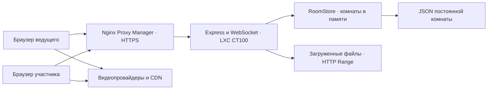

# Как устроен SyncPlayer

SyncPlayer — веб-приложение для синхронного просмотра. Каждый зритель запускает обычный браузер. Один процесс Node.js раздаёт интерфейс, принимает команды комнаты, хранит состояние и рассылает его всем участникам.

## Стек и основные файлы

| Слой      | Где смотреть                                                                                                                                                                        | Что делает                                                                                                                                                                            |
| --------- | ----------------------------------------------------------------------------------------------------------------------------------------------------------------------------------- | ------------------------------------------------------------------------------------------------------------------------------------------------------------------------------------- |
| Интерфейс | [public/index.html](../public/index.html), [public/style.css](../public/style.css), [public/app.js](../public/app.js)                                                               | Адаптивная разметка, формы, очередь, чат и обновления состояния. Браузер загружает ES-модули напрямую.                                                                                |
| Плеер     | [public/players.js](../public/players.js)                                                                                                                                           | Единый интерфейс команд для HTML5 Video, HLS.js и внешних плееров. Отдельные адаптеры преобразуют команды и события провайдеров.                                                      |
| Сервер    | [src/server/index.mjs](../src/server/index.mjs), [src/server/app.mjs](../src/server/app.mjs)                                                                                        | Node.js 24, Express для HTTP API, `ws` для WebSocket, Busboy для потоковой загрузки, Zod для входных данных, Helmet для заголовков безопасности.                                      |
| Комнаты   | [src/server/rooms.mjs](../src/server/rooms.mjs), [src/server/room-owner.mjs](../src/server/room-owner.mjs)                                                                          | Состояние комнат, роли, очередь, позиция воспроизведения, сессии и профиль владельца.                                                                                                 |
| Источники | [src/server/sources.mjs](../src/server/sources.mjs), [src/server/page-discovery.mjs](../src/server/page-discovery.mjs), [src/server/fixed-fetch.mjs](../src/server/fixed-fetch.mjs) | Проверка ссылок, импорт поддерживаемых каталогов и анализ ограниченного HTML через parse5. Сетевой слой проверяет DNS, закрепляет публичный IPv4 и ограничивает время и объём ответа. |
| Диск      | [src/server/uploads.mjs](../src/server/uploads.mjs), [deploy/storage-maintenance.mjs](../deploy/storage-maintenance.mjs)                                                            | Учёт загрузок, резерв места, автоматическая очистка и разовая инвентаризация.                                                                                                         |

## Как синхронизируется просмотр

1. При входе сервер выдаёт cookie сессии комнаты. После подключения WebSocket браузер получает состояние комнаты и загружает текущее видео.
2. Любой участник отправляет play, pause или seek по HTTP. Сервер проверяет сессию и версию источника, обновляет позицию и рассылает новое состояние по WebSocket.
3. Браузер сверяет позицию с серверной отметкой времени и корректирует заметное расхождение. Участник, который последним управлял плеером, периодически обновляет позицию. Сервер учитывает ревизию при фоновых обновлениях, чтобы они не отменили свежую команду.
4. Загруженный файл отдаётся диапазонами HTTP Range с LXC. Внешние ссылки и плееры загружает браузер каждого зрителя. Кодеки, CORS, запрет встраивания и задержки прямого эфира зависят от браузера и провайдера.

Ведущий управляет модерацией очереди, подтверждением встреч и запуском рулетки. Роль ведущего может перейти другому участнику. Профиль владельца постоянной комнаты даёт право её закрыть даже после выхода.

## Данные и эксплуатация

- Временные комнаты находятся в памяти и пропадают при рестарте. Единственная постоянная комната хранится в `DATA_DIR/permanent-room.json` и после запуска восстанавливается на паузе. Очередь, чат и расписание находятся в том же JSON. Отдельная база данных отсутствует.
- На сервере рабочие данные лежат в `/var/lib/syncplayer`, видео — в подкаталоге `uploads`. Приложение пишет входящий файл частями, публикует его в очереди после проверки, удаляет незавершённые загрузки и файлы просроченных комнат. Целевой потолок загрузок по умолчанию 10 ГиБ плюс отдельный минимальный запас свободного места 512 МиБ. Режим одного процесса нужен, чтобы очереди и квоты оставались согласованными.
- HTTPS завершается в Nginx Proxy Manager. Он отправляет HTTP и WebSocket в Debian LXC №100 по `192.168.0.16:3000`. App работает через systemd под `syncplayer`. Пользователь `deploy` устанавливает релиз по SHA из GitHub, а привилегированный переключатель активирует его, проверяет `/api/health` и откатывает при неудачной проверке запуска.
- Для работы локально используйте `npm ci`, `npm run dev` и две браузерные сессии. `npm run check` запускает линтер, формат-проверку и серверные тесты. `npm run test:e2e` проверяет браузерные сценарии. Выпуск и очистка описаны в [руководстве LXC](../deploy/README.md).

Открытый DASH и индивидуальные статусы готовности участников, затем расширение для Chromium и Firefox описаны в [roadmap](../CODEX_SYNCPLAYER_ROADMAP.md).
